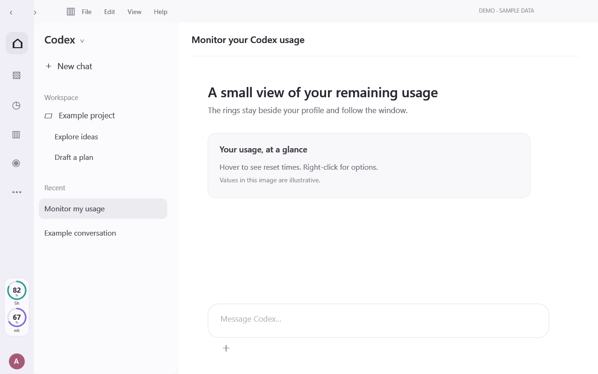

# Codex Quota Rings · Codex 额度监控圆环

A Windows desktop widget for monitoring Codex usage limits and remaining quota beside your profile avatar. It follows the desktop window and refreshes automatically.

一个 Codex 额度监控与用量查询桌面挂件：在头像上方显示剩余额度，支持 Windows 窗口跟随和自动刷新。

[中文说明](README.zh-CN.md) · [Download the latest release](https://github.com/lilongxin155/codex-quota-rings/releases/latest)



> This is an illustrative interface made with fictional data. It does not show an actual account or conversation.

## Features

- Two rings show the remaining percentage for the short and long usage windows returned by Codex (for example, 5 hours and one week). Actual window lengths depend on your account.
- Refreshes every 10 seconds; click a ring to refresh now. Hover to see reset times and the last successful refresh.
- Follows the Codex window when it moves, maximizes, minimizes, closes, or reopens.
- Sleeps when Codex is minimized, hidden, cloaked on another virtual desktop, off-screen, or fully covered by ordinary opaque windows. The widget UI and its quota-reader process exit; only the lightweight monitor stays running. Showing Codex again starts an immediate refresh, then resumes the 10-second schedule. Partial visibility keeps it active; potentially translucent layered windows are treated conservatively.
- Checks for the navigation rail update action and moves out of its way when their rectangles overlap. Detection recognizes English and Chinese update labels; you can also move the widget with its right-click menu.
- A gray ring indicates stale data. A dash means a limit is unavailable, rather than a fabricated value.
- Interface text follows Windows' display language: Chinese for Chinese locales, English otherwise.

## Requirements

- Windows 10 or 11, 64-bit, with .NET Framework 4.8.
- The Codex desktop app installed and signed in, with a local Codex CLI that provides `codex app-server` under `%LOCALAPPDATA%\OpenAI\Codex\bin`.
- A ChatGPT account for which Codex reports usage limits. The limits and reset windows vary by account; a daily limit is shown only if the server actually returns one.

This is an independent overlay, not an official OpenAI application or an embedded extension. It relies on the current Codex desktop window and app-server interface; a future Codex update could require a compatibility fix. It also appears in other modes that share the same desktop window.

## Install

1. Download `CodexQuotaRings-windows-x64.zip` from the [latest release](https://github.com/lilongxin155/codex-quota-rings/releases/latest) and extract the entire archive.
2. Double-click `Install.cmd`. This copies the app to `%LOCALAPPDATA%\CodexQuotaRings`, creates a per-user Windows scheduled task to start it at sign-in, and starts it now. No administrator elevation is intended.
3. Open or return to Codex. The rings appear above the profile avatar once usage data is available.

The downloadable executable is not code-signed, so Windows may show a publisher or SmartScreen warning. The source and build steps below are available if you prefer to inspect and build it yourself.

### Controls and removal

Click to refresh; hover for details; right-click to refresh, move the rings, restore their position, or pause them. To resume after pausing, open **Codex Quota Rings** from the Windows Start menu.

To uninstall, run `%LOCALAPPDATA%\CodexQuotaRings\Uninstall.cmd`. It removes the app's scheduled task, Start menu shortcut, executable, and its own local state files. Other files placed in that folder are left in place.

## Privacy

The widget asks the locally installed Codex app-server for `account/rateLimits/read`, using the existing Codex sign-in. The widget does not separately collect or upload credentials or usage data. The Codex app-server may contact OpenAI as part of its normal operation.

The app writes local status and error files in its installation folder. These can reveal usage percentages, timestamps, window details, or local file paths. **Review and redact them before sharing a bug report.** The update-button check reads accessibility labels and positions from the Codex window in memory; it does not save the labels.

## Build from source

Open PowerShell in the repository root and run:

```powershell
powershell.exe -NoProfile -ExecutionPolicy Bypass -File .\scripts\Build.ps1
```

This uses the .NET Framework compiler included with Windows and writes the executable and configuration to `release/`. To install a self-built copy, copy `scripts/Install.ps1`, `Install.cmd`, `Uninstall.ps1`, `Uninstall.cmd`, and `Launch.vbs` into `release/`, then run `release\Install.cmd`.

## Troubleshooting

- **No rings:** open the Codex desktop app and confirm that the account can see usage limits. Wait a few seconds. The app-server location above must exist.
- **Gray rings or dashes:** hover for the error or wait for the next refresh. A service error or an unavailable limit is not interpreted as zero.
- **Update button overlaps:** right-click the rings and choose **Move up**. Automatic avoidance depends on accessible labels and the current Codex interface.
- **Paused:** open **Codex Quota Rings** from Start to resume. Right-clicking **Pause widget** persists until resumed.
- **Installation fails:** make sure the complete ZIP is extracted and Task Scheduler is available for the current Windows user. The installer will not overwrite an unrelated scheduled task with the same name.

Issues and pull requests are welcome. Before sharing screenshots or diagnostics, remove account information and private paths. See [CONTRIBUTING.md](CONTRIBUTING.md).

## License

[MIT](LICENSE). Codex and OpenAI are trademarks of their respective owners; this project is not affiliated with or endorsed by OpenAI.
